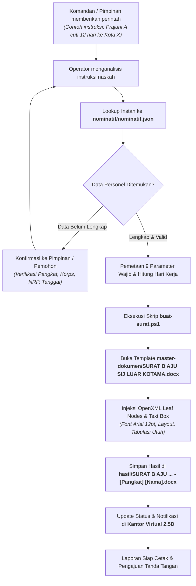

# 🪖 SISTEM ADMINISTRASI STAF PERSONALIA (SPERS) YONIF 735/NAWASENA
### Otomasi Pembuatan Surat Bentuk B & Kantor Virtual Administratif 2.5D

Selamat datang di repositori operasional **Staf Personalia (Spers) Batalyon Infanteri 735/Nawasena**. Sistem ini menggabungkan otomasi pembuatan naskah dinas militer berpresisi tinggi (khususnya **Surat Bentuk B**) dengan antarmuka visual **Kantor Virtual 2.5D (Pixel-Art Isometric)** untuk memonitor aktivitas staf secara interaktif.

---

## 📑 DAFTAR ISI
1. [Gambaran Umum](#-gambaran-umum)
2. [Struktur Direktori Proyek](#-struktur-direktori-proyek)
3. [Susunan Personel & Tugas (Staff Office)](#-susunan-personel--tugas-staff-office)
4. [Alur Kerja (Workflow Pipeline)](#-alur-kerja-workflow-pipeline)
5. [Petunjuk Penggunaan](#-petunjuk-penggunaan)
   - [A. Menjalankan Kantor Virtual](#a-menjalankan-kantor-virtual)
   - [B. Membuat Surat via Perintah Chat](#b-membuat-surat-via-perintah-chat)
   - [C. Menjalankan Skrip Otomasi Mandiri (CLI)](#c-menjalankan-skrip-otomasi-mandiri-cli)
6. [Aturan Emas Dokumen (Golden Rules)](#-aturan-emas-dokumen-golden-rules)
7. [Catatan Teknis & Pemecahan Masalah](#-catatan-teknis--pemecahan-masalah)

---

## 🏛️ GAMBARAN UMUM

Sistem ini didesain khusus untuk memenuhi tata naskah dinas militer TNI AD di lingkungan Yonif 735/Nawasena (Brigif 27/Nusa Ina). 

**Fitur Pokok:**
- **Pencarian Data Kilat (< 0.05 Detik)**: Membaca database personel terstruktur dari format JSON (`nominatif.json`) yang memuat data terverifikasi.
- **Injeksi OpenXML Tanpa Cacat**: Menghasilkan dokumen Microsoft Word (`.docx`) dengan mempertahankan format baku (Font Arial 12pt, tabulasi, kop satuan, text-box, garis pembatas, dan margin resmi) tanpa merusak struktur dokumen master.
- **Kantor Virtual 2.5D**: Menampilkan aktivitas kerja staf pers (Danyonif, Pasi Pers, Bamin Pers, Sertu Ricat, Pratu Yacob, dan Pratu Lalaun) secara live di browser lengkap dengan dialog kedinasan, dosir, dan disposisi.

---

## 📁 STRUKTUR DIREKTORI PROYEK

```text
staf-pers/
├── README.md                      # Petunjuk lengkap, alur, dan struktur aplikasi
├── agent.md                       # SOP, panduan karakter, golden rules, dan panduan teknis agen
├── buat-surat.ps1                 # Engine otomatisasi OpenXML Word untuk injeksi Surat Bentuk B
├── buka-kantor-virtual.ps1        # Launcher 1-klik untuk menyalakan server & membuka browser
│
├── master-dokumen/                # TEMPLATE DOKUMEN MASTER (LOKAL)
│   ├── .gitkeep                   # Penanda struktur folder di repositori
│   └── SURAT B AJU SIJ LUAR KOTAMA.docx   # Master Surat Bentuk B Izin Jalan Keluar Kotama
│
├── nominatif/                     # DATABASE NOMINATIF (LOKAL)
│   ├── convert_nominatif.py       # Skrip konversi dari Excel ke format JSON/JSONL
│   ├── nominatif.json             # Database personel terstruktur (Lokal)
│   └── ...                        # File database lokal lainnya (tidak diupload)
│
├── hasil/                         # FOLDER OUTPUT NASKAH DINAS (LOKAL)
│   ├── .gitkeep                   # Penanda struktur folder di repositori
│   └── SURAT B AJU ... .docx      # Berkas surat dinas hasil generate (Lokal)
│
└── kantor-virtual/                # APLIKASI KANTOR VIRTUAL 2.5D (VITE + REACT + NODE)
    ├── package.json               # Konfigurasi dependensi (Node.js/npm)
    ├── vite.config.ts             # Konfigurasi bundler Vite
    ├── server/                    # Backend server (Express & WebSocket di port 3334)
    │   ├── index.js               # Titik masuk server backend
    │   ├── chat-db.js             # Penyimpanan riwayat chat (JSON fallback mode)
    │   ├── health.js              # Endpoint status server (/health)
    │   └── tasks.js               # Pengelola task kantor virtual
    ├── src/                       # Antarmuka frontend (React TypeScript)
    │   ├── App.tsx                # Layout utama & inisialisasi karakter staf
    │   ├── officeReducer.ts       # Manajemen state kantor, percakapan, & event
    │   ├── events.ts              # Generator skenario dialog & aktivitas militer
    │   ├── interactions.ts        # Interaksi antar staf (dosir, disposisi, paraf)
    │   ├── components/            # Komponen visual (CharacterSettings, AgentCard, dll.)
    │   └── styles/                # CSS kustom (inspector.css card 440px no-truncate)
    └── dist/                      # Hasil build produksi siap tayang
```

---

## 👥 SUSUNAN PERSONEL & TUGAS (STAFF OFFICE)

| No | Personel | Kategori Peran | Peran & Tugas di Kantor Virtual |
|:--:|:---|:---|:---|
| **1** | **DANYONIF** | Pimpinan Satuan | **Komandan Batalyon Yonif 735/Nawasena**<br>Otoritas tertinggi pengesahan dan penandatanganan Surat Bentuk B serta pengambil keputusan izin dan cuti. |
| **2** | **PASI PERS** | Perwira Seksi | **Perwira Seksi Personalia (Pasi Pers)**<br>Pemeriksa naskah dinas, verifikator kepatuhan Jukminu TNI, dan pemberi paraf koordinasi sebelum diajukan ke Danyonif. |
| **3** | **BAMIN PERS** | Bintara Staf | **Bintara Administrasi Personalia (Asisten Pers)**<br>Pendamping staf, notulen disposisi, dan pengelola pencatatan administrasi harian ruang pers. |
| **4** | **SERTU RICAT** | Bintara Operator | **Operator Utama SURAT B & Naskah Dinas**<br>Menerima instruksi, mengekstrak data dari database nominatif, mengeksekusi pembuatan Surat Bentuk B via `buat-surat.ps1`, dan memastikan naskah siap cetak. |
| **5** | **PRATU YACOB** | Tamtama Operator | **Taopr Data / Sisfopers Minpers**<br>Operator administrasi Surat Izin Jalan (SIJ), sinkronisasi data nominatif prajurit, dan validasi kalender hari kerja cuti. |
| **6** | **PRATU LALAUN** | Tamtama Staf | **Ta Urusan Surat Permohonan Izin Nikah**<br>Mengelola verifikasi berkas izin nikah personel, kelengkapan administrasi calon persit, dan dosir pernikahan dinas. |

---

## 🔄 ALUR KERJA (WORKFLOW PIPELINE)

Alur kerja dari pemberian perintah sampai dokumen Word siap dicetak diilustrasikan dalam diagram berikut:



### 9 Parameter Wajib Surat Bentuk B:
1. **Nama**: Nama lengkap prajurit (Kapital awal kata / sesuai data dinas).
2. **Pangkat/NRP**: Format baku `Pangkat/NRP` (contoh: `Serda/31xxxxxxxxxx`).
3. **Jabatan**: Jabatan struktural satuan (contoh: `Danru / Ba / Ta Yonif 735/Nawasena`).
4. **Tujuan**: Rincian tujuan perjalanan (Desa/Kec/Kabupaten/Provinsi).
5. **Pengikut**: Istri, Anak, atau tanda `-` (Nihil).
6. **Keperluan**: Cuti Tahunan, Cuti Istimewa, atau Izin Khusus.
7. **Berangkat tanggal**: Format `[Hari], [Tanggal] [Bulan] [Tahun]`.
8. **Kembali tanggal**: Dihitung dari durasi hari kerja dinas (Senin s.d. Jumat).
9. **Nomor HP**: Nomor kontak aktif prajurit.

---

## 🚀 PETUNJUK PENGGUNAAN

### A. Menjalankan Kantor Virtual
Untuk melihat aktivitas meja staf secara visual dalam nuansa pixel art 2.5D:
1. Buka PowerShell di folder proyek `staf-pers`.
2. Jalankan launcher otomatis:
   ```powershell
   .\buka-kantor-virtual.ps1
   ```
3. Browser default akan terbuka otomatis mengarah ke:
   ```text
   http://127.0.0.1:3334/#token=<token-anda>
   ```
4. Anda dapat melihat:
   - **Meja Kerja 6 Personel Staf Pers**: Danyonif, Pasi Pers, Bamin Pers, Sertu Ricat, Pratu Yacob, dan Pratu Lalaun.
   - **Card Detail Staf** (lebar proporsional tanpa pemotongan teks nama/jabatan).
   - **Percakapan dinas militer berbahasa Indonesia** seputar Surat B, permohonan cuti, dosir, dan disposisi pimpinan.
   - **Menu Pengaturan Karakter (🪖)**: Tersedia 37 pilihan gaya karakter prajurit (Pria & Kowad).

---

### B. Membuat Surat via Perintah Chat
Cukup berikan instruksi langsung ke Agen (Operator) dengan bahasa wajar di terminal atau chat kantor. Sistem akan otomatis mencari data di database dan memproses dokumennya.

**Contoh Format Instruksi:**
> *"Buatkan Surat B cuti tahunan ke [Kota Tujuan] berangkat tanggal [Tgl Berangkat] selama [Jumlah] hari kerja, pengikut istri dan anak"*

Agen akan langsung:
1. Menemukan profil prajurit dari database nominatif.
2. Menghitung tanggal kembali kerja secara presisi (di luar hari libur).
3. Mengambil nomor agenda surat dinas aktif.
4. Menerbitkan berkas di `hasil/SURAT B AJU SIJ LUAR KOTAMA - [Pangkat] [Nama].docx`.

---

### C. Menjalankan Skrip Otomasi Mandiri (CLI)
Anda juga dapat mengeksekusi skrip PowerShell [`buat-surat.ps1`](file:///C:/Users/LEGION/Documents/project/staf-pers/buat-surat.ps1) secara langsung dari terminal:

```powershell
.\buat-surat.ps1 `
    -Nama "Nama Prajurit" `
    -PangkatNRP "Serda/31xxxxxxxxxx" `
    -Jabatan "Bamin Kompi Yonif 735/Nawasena" `
    -Tujuan "Kota Tujuan, Provinsi" `
    -Pengikut "Istri dan Anak" `
    -Keperluan "Cuti Tahunan (12 Hari Kerja)" `
    -Berangkat "Senin, 02 November 2026" `
    -Kembali "Sabtu, 14 November 2026" `
    -NomorHP "08xx-xxxx-xxxx" `
    -NomorSurat "B /  132  /  XI  /  2026" `
    -TanggalSurat "Langgur, 02 November 2026"
```

Dokumen hasil akan otomatis tersimpan rapi di folder `hasil/`.

---

## 🛡️ ATURAN EMAS DOKUMEN (GOLDEN RULES)

> [!IMPORTANT]
> **STANDAR BAKU FORMAT NASKAH DINAS MILITER:**
> 1. **Dilarang Mengubah Tata Letak**: Kop surat, jarak baris (line spacing), batas margin halaman (kiri/kanan/atas/bawah), dan jenis font (**Arial 12 pt**) adalah standar ketat dinas TNI.
> 2. **Hanya Ubah Isian Variabel**: Teks setelah tanda titik dua (`:`) pada poin a s.d. i, nomor surat, tanggal surat, dan tanda tangan Komandan adalah satu-satunya data yang dimodifikasi.
> 3. **Database JSON Bersifat Read-Only**: Jangan mengedit langsung file database utama saat memproses surat.
> 4. **Semua Output Masuk Folder `hasil/`**: Jangan pernah menimpa file master di dalam folder `master-dokumen/`.

---

## 🔧 CATATAN TEKNIS & PEMECAHAN MASALAH

1. **Manipulasi OpenXML Word (`mc:AlternateContent`)**:
   - Template Word militer menggunakan text-box ganda (`mc:Choice` drawingML dan `mc:Fallback` VML).
   - Skrip `buat-surat.ps1` secara spesifik menargetkan elemen paragraf terdalam (`w:p[not(.//w:p)]`) agar tidak merusak kontainer drawing/textbox pembungkus.
2. **Kesesuaian Node.js di Windows**:
   - Backend `kantor-virtual/server` disetel menggunakan storage fallback aman, sehingga **tidak membutuhkan kompilasi C++ Visual Studio** (`better-sqlite3`).
3. **Card Agent & CSS Inspector**:
   - Komponen `AgentCard` pada kantor virtual memiliki lebar dinamis dengan properti CSS `white-space: normal` dan `word-break: break-word` agar pangkat dan jabatan dinas tidak terpotong (truncated).
4. **Pusat Pengaturan Karakter Staf (Modal Setting ⚙️ / 🪖)**:
   - Antarmuka visual kantor virtual dilengkapi pengaturan karakter untuk seluruh 6 personel staf pers di kantor.
   - Dilengkapi 37 koleksi gaya karakter prajurit (Prajurit Pria, Kowad, Bamin, Operator Sisfopers, Provost, Perwira Staf) dengan pencarian cepat dan filter gender.
5. **Kebijakan Keamanan & Privasi Data**:
   - Sesuai prinsip kerahasiaan administrasi satuan, berkas naskah dinas tercetak di `hasil/`, template dinas di `master-dokumen/`, dan arsip nominatif personel (Excel/JSON) **tidak diunggah ke repositori publik** (terlindungi oleh `.gitignore` dan `.gitkeep`).
   - Skrip konversi [`nominatif/convert_nominatif.py`](file:///C:/Users/LEGION/Documents/project/staf-pers/nominatif/convert_nominatif.py) disertakan agar satuan dapat membuat basis data JSON secara mandiri dari master nominatif internal.

---

## 🌐 REPOSITORI RESMI
Repositori proyek ini dipublikasikan di:
**[https://github.com/carissadarmafissaleha/staf-pers.git](https://github.com/carissadarmafissaleha/staf-pers.git)**

---

*Disusun oleh **Staf Personalia (Spers) Yonif 735/Nawasena**.*
